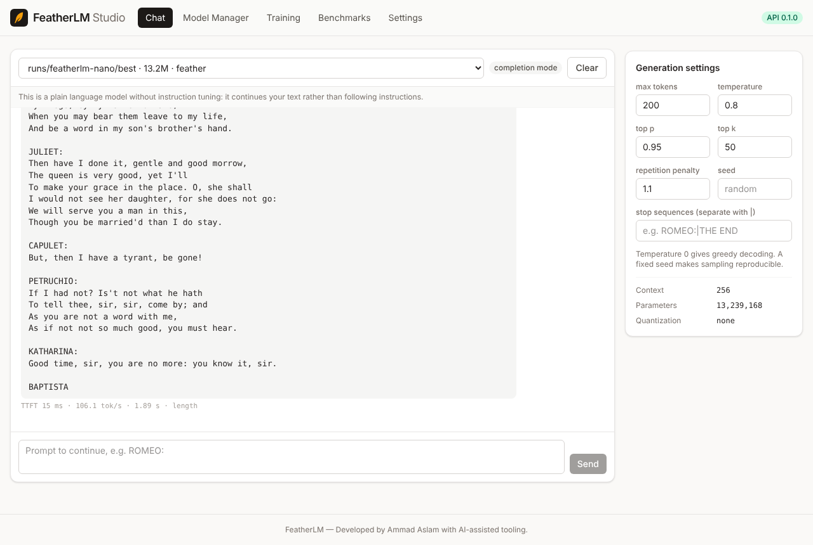
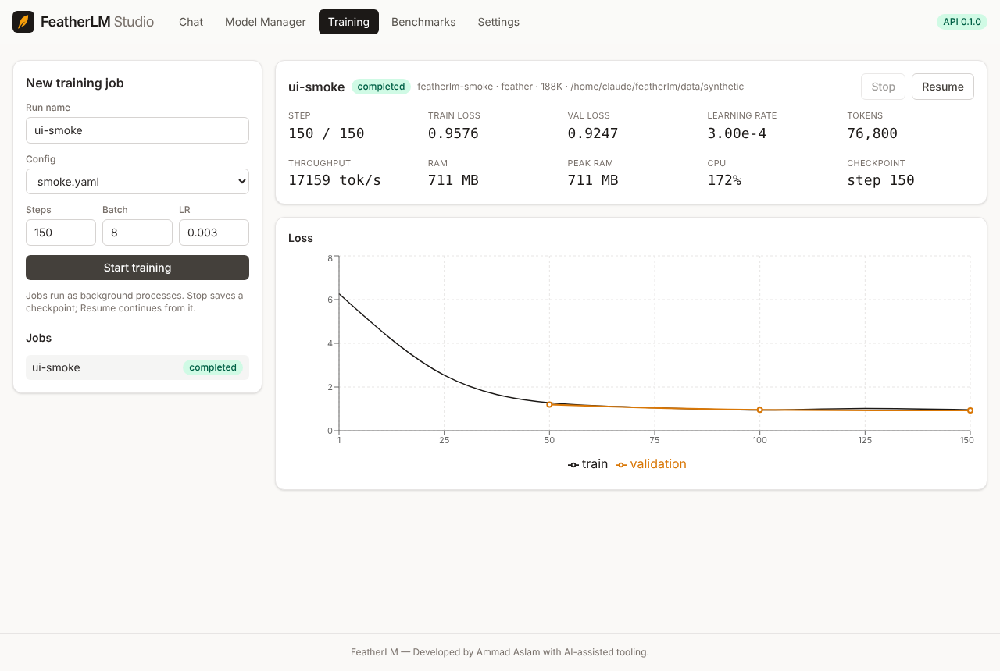

# FeatherLM

**A hardware-efficient language model you can train and run on an ordinary CPU.**

*Developed by Ammad Aslam with AI-assisted tooling.*

FeatherLM is a research codebase for one question: can a language model need substantially
less memory to train and run than a comparable Transformer? It contains a complete,
tested pipeline: tokenizer, two model backends, CPU training, fine-tuning, quantization,
ONNX export, an OpenAI-style REST API, a web UI (FeatherLM Studio), Docker deployment and
mobile inference prototypes.

The first released model, **FeatherLM Nano** (13.2M parameters), is trained from random
weights on a 2-core CPU. It is a small research model, not an assistant: it writes
Shakespeare-flavoured text and does not follow instructions.



## Status at a glance

| Area | Status |
|---|---|
| Byte-level BPE tokenizer | done, tested |
| Transformer baseline (GQA, RoPE, RMSNorm, SwiGLU, KV cache) | done, tested |
| Experimental Feather core (gated recurrence + local attention + optional weight sharing) | done, tested against a sequential reference |
| CPU training from scratch, checkpoints, resume, early stopping, peak-RAM reporting | done, tested; Nano trained |
| Fine-tuning: continued pretraining, SFT (JSONL), LoRA | done, tested |
| Generation: greedy, temperature, top-k, top-p, repetition penalty, stop sequences, streaming | done, tested |
| Quantization (FP16 / INT8 / INT4) + ONNX export + validation | done, tested |
| Benchmarks (quality across seeds, memory, speed) | done; results in `results/` and `docs/benchmarks.md` |
| FastAPI server, auth, limits, background training jobs | done, tested |
| FeatherLM Studio (React + TypeScript + Vite + Tailwind) | built; talks to the API |
| Docker / compose / cloud scripts | written and syntax-checked; **image not built here** (no Docker daemon or registry access in the dev environment) |
| Android / iOS | source prototypes; **not built or run on devices**. The inference loop is tested on desktop ONNX Runtime |

See [Known limitations](#known-limitations) before drawing conclusions.

## Quick start (CPU)

```bash
./scripts/setup.sh                       # Windows: powershell -ExecutionPolicy Bypass -File scripts\setup.ps1
source .venv/bin/activate

# Data: Tiny Shakespeare (public domain)
python -m featherlm.data.prepare --download tinyshakespeare --out data/shakespeare --vocab-size 8192

# Train FeatherLM Nano (about 25-60 min on 2 cores; early stopping is on)
python train.py --config configs/nano_cpu.yaml

# Generate (best/ = lowest validation loss; final/ = weights at the last step)
python inference.py --model runs/featherlm-nano/best --prompt "ROMEO:" --max-new-tokens 80
python inference.py --model runs/featherlm-nano/best --chat         # interactive terminal

# Evaluate (loss, perplexity, bits per byte, top-1/top-5 accuracy)
python evaluate.py --model runs/featherlm-nano/best --data data/shakespeare

# API + Studio
python -m uvicorn api.main:app --host 127.0.0.1 --port 8000
# open http://127.0.0.1:8000  (OpenAPI docs at /docs)
```

## Commands

| Task | Command |
|---|---|
| Train from scratch | `python train.py --config configs/nano_cpu.yaml` |
| Override config values | `python train.py --config configs/nano_cpu.yaml --set training.max_steps=200 --set training.batch_size=4` |
| Matched Transformer baseline | `python train.py --config configs/nano_transformer_cpu.yaml` |
| Resume after interruption | re-run the same command (`--no-resume` to start over) |
| Fine-tune / SFT / LoRA | `python finetune.py --config <config with finetune.init_from>` |
| Quantize | `python -m featherlm.export.quantize --model runs/featherlm-nano/final --mode int8 --out models/featherlm-nano-int8` |
| ONNX export | `python -m featherlm.export.onnx_export --model runs/featherlm-nano/final --out models/featherlm-nano-onnx` |
| Validate exports | `python -m featherlm.export.validate --reference runs/featherlm-nano/final --candidates models/featherlm-nano-int8 --onnx models/featherlm-nano-onnx --data data/shakespeare` |
| All benchmarks | `./scripts/run_benchmarks.sh` |
| Tests (91, CPU only) | `python -m pytest` |
| Docker (local) | `docker compose up -d --build` |
| Docker (production, inference only) | `docker compose -f docker-compose.prod.yml up -d` |
| Cloud VM deploy | `./scripts/deploy.sh runs/featherlm-nano/final` (see `docs/deployment.md`) |
| Frontend dev server | `cd frontend && npm run dev` |

### FeatherLM Studio

Five sections: Chat (streaming, generation settings, TTFT and tok/s, stop, clear), Model
Manager (architecture, parameters, size, quantization, context, memory estimate, checkpoint
import), Training (start/stop/resume background jobs with live loss, RAM, CPU and checkpoint
status), Benchmarks (charts from `results/`) and Settings.



## REST API

OpenAI-style endpoints (`/v1/completions` works with the OpenAI client's `base_url`):

```bash
curl http://127.0.0.1:8000/v1/completions -H "Content-Type: application/json" \
  -d '{"model": "runs/featherlm-nano/best", "prompt": "ROMEO:", "max_tokens": 60, "temperature": 0.8, "stream": false}'
```

| Endpoint | Purpose | Auth |
|---|---|---|
| `GET /health` | liveness, version, loaded models | none |
| `GET /v1/models`, `GET /v1/models/{id}` | models with architecture, params, size, quantization, context, capabilities | API key |
| `POST /v1/completions` | text completion, SSE streaming with `"stream": true` | API key |
| `POST /v1/chat/completions` | chat; **only for models with the `featherlm-v1` chat template**, else 400 | API key |
| `GET /metrics` | Prometheus metrics | API key |
| `POST /training/jobs`, `GET /training/jobs/{id}`, `POST .../stop`, `POST .../resume` | background training | admin |
| `POST /models/import` | import a safetensors checkpoint zip | admin |
| `GET/PUT /settings`, `GET /system`, `GET /benchmarks` | Studio support | API key / admin for PUT |

Authentication: `Authorization: Bearer <key>`. With no keys configured the server is in
local mode: inference is open and admin routes accept only direct loopback connections.

## Repository layout

```
featherlm/            Python package
  model/              config, embeddings, attention (GQA/RoPE/KV cache), recurrent (Feather core), blocks, model, generation
  tokenizer/          byte-level BPE + trainer
  data/               preparation, memory-mapped datasets, packing, SFT data
  training/           trainer, optimizers/schedule, safetensors checkpoints, metrics/memory, LoRA
  inference/          engine, sampling, streaming
  export/             quantization, ONNX export, validation
  benchmarks/         memory, speed, matched-budget quality comparison
api/                  FastAPI app (routes, schemas, services: models, jobs, security, metrics)
frontend/             FeatherLM Studio (React + TypeScript + Vite + Tailwind)
mobile/               Android (Kotlin) and iOS (Swift) prototypes + tested desktop reference runtime
configs/              nano/tiny/mobile/desktop presets, matched baseline, benchmark spec, smoke test
scripts/              setup (sh/ps1), train, deploy, run_benchmarks
deploy/               nginx and systemd configs
docs/                 architecture, training, benchmarks, deployment, research report
results/              benchmark outputs (JSON/CSV/PNG)
tests/                pytest suite (CPU only)
train.py inference.py evaluate.py finetune.py
```

## Model family

| Variant | Config | Parameters (computed) | Purpose | Trained here? |
|---|---|---|---|---|
| Nano | `configs/nano_cpu.yaml` | 13.2M | architecture development | **yes** (Tiny Shakespeare) |
| Tiny | `configs/tiny_cpu.yaml` | 67.1M | small-scale language training | no |
| Mobile | `configs/mobile.yaml` | 210.4M | edge inference experiments | no |
| Desktop | `configs/desktop.yaml` | 679.8M | higher-capacity research | no (needs a GPU or large VM) |

## Results so far

Measured on a 2-vCPU Xeon with 7.8 GB RAM, no GPU. Details: `docs/benchmarks.md`, `docs/research.md`.

* **Nano trains on CPU:** 13.2M params, loss 9.01 → 3.08, 40 min, peak RSS 2.15 GB (1.26 GB with gradient checkpointing).
* **Constant inference memory:** Feather's decode state is 0.146 MB at 256, 1,024 or 4,096 tokens of context; the matched Transformer's KV cache grows 1.5 → 24 MB. Decode at 2,048 tokens: 189 vs 118 tok/s.
* **Quality is not better (yet):** on Nano the parameter-matched Transformer reached lower validation loss (5.02 vs 5.13). At 4M params across 3 seeds the architectures are within noise of each other; a weight-shared Feather matched the Transformer with 21% fewer parameters.
* **INT8 is effectively lossless:** 50.5 → 12.8 MB, perplexity 174.04 → 173.98. INT4: 7.2 MB, +2% perplexity.

## Known limitations

* **Data.** Nano was trained on Tiny Shakespeare (~300k tokens) because larger licensed
  corpora were not reachable from the development environment. A 13M-parameter model
  overfits this quickly; early stopping picks the best validation checkpoint. The text it
  produces is locally plausible but incoherent.
* **Evidence.** The architecture comparison is small-scale (4M-13M parameters, one dataset,
  a few hundred steps, three seeds). It does not show that the Feather core is better than a
  Transformer in general; see `docs/research.md`.
* **No instruction following.** No instruction-tuned model is shipped; `/v1/chat/completions`
  is disabled for the base model by design.
* **Speed.** The recurrence and per-token decode loop are plain PyTorch; there are no custom
  CPU kernels yet.
* **ONNX** export is fixed-window (O(window) work per token); llama.cpp/GGUF is not supported
  because the Feather architecture would need a custom backend there.
* **Docker image, Android and iOS builds** are untested in this environment (see table above).
* **GPU training** (`training.device=cuda`) is implemented but untested here (no GPU).

## Next development priorities

1. Train on a larger licensed corpus (e.g. 100M+ tokens) where the architecture comparison is meaningful.
2. Stateful single-step ONNX export for constant-memory decoding on mobile.
3. Fused CPU kernel for the recurrence scan and an INT8 matmul runtime.
4. Build and profile the Android app on real hardware; then the iOS package.
5. Longer-context evaluation, where the Feather core's fixed-size state should matter most.

## License and credits

MIT License, © 2026 Ammad Aslam. Developed by Ammad Aslam with AI-assisted tooling.
Tiny Shakespeare consists of public-domain works of William Shakespeare, as compiled in
the karpathy/char-rnn repository (MIT).
