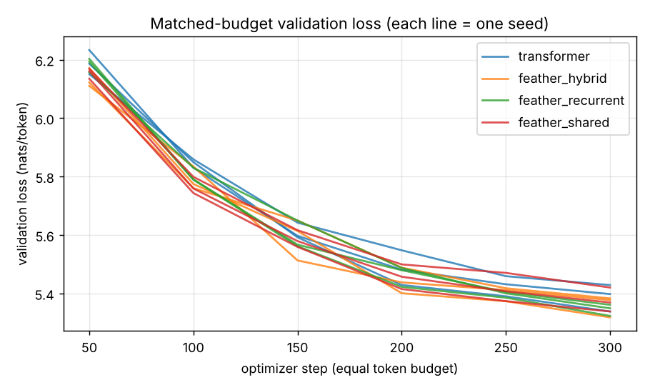

# Benchmarks

*Developed by Ammad Aslam with AI-assisted tooling.*

Generated by `scripts/make_report.py` from the JSON files in `results/`. Reproduce everything with `./scripts/run_benchmarks.sh`.

## Hardware and software

- CPU: Intel(R) Xeon(R) Processor @ 2.10GHz (2 logical cores, 2 torch threads)
- RAM: 8,028 MB total; CUDA available: False
- OS: Linux 6.18.44-fc-v185; Python 3.13.18; PyTorch 2.15.0+cu132

## FeatherLM Nano vs. matched Transformer (Tiny Shakespeare)

Same tokenizer, data, sequence length (256), batch (8×2 accumulation), optimizer, learning-rate schedule, dropout and early-stopping rule. Parameter counts matched within 0.02%. One seed each (these runs take ~30-40 min on 2 cores). Validation metrics are from the **best** checkpoint, evaluated with `evaluate.py`.

| model | backend | params | steps | best_val_step | val_loss | perplexity | bits_per_byte | top1_accuracy | peak_train_rss_mb | train_tokens_per_sec | train_time_min |
|---|---|---|---|---|---|---|---|---|---|---|---|
| featherlm-nano | feather | 13,239,168 | 600 | 300 | 5.1312 | 169.2 | 2.3602 | 0.2269 | 2,153.8 | 1,414.8 | 40.0 |
| featherlm-nano-transformer | transformer | 13,237,632 | 800 | 500 | 5.0220 | 151.7 | 2.3100 | 0.2394 | 2,077.3 | 1,535.6 | 35.7 |

## Matched-budget comparison across seeds

Spec: `configs/bench_micro.yaml`. d_model=192, 6 layers, seq_len=128, batch=16, steps=300 (identical token budget), seeds=[0, 1, 2]. Final validation loss after the last step.

| arch | n_seeds | params | val_loss_mean | val_loss_std | val_ppl_mean | peak_train_rss_mb_mean | train_tokens_per_sec_mean | train_time_s_mean |
|---|---|---|---|---|---|---|---|---|
| transformer | 3 | 4,100,544 | 5.3885 | 0.0460 | 218.9 | 1,413.6 | 3,263.9 | 190.2 |
| feather_hybrid | 3 | 4,100,544 | 5.3597 | 0.0358 | 212.7 | 1,471.7 | 3,636.2 | 170.9 |
| feather_recurrent | 3 | 4,183,488 | 5.3446 | 0.0194 | 209.5 | 1,477.4 | 3,705.0 | 167.6 |
| feather_shared | 3 | 3,230,400 | 5.3760 | 0.0413 | 216.2 | 1,464.0 | 3,594.0 | 172.9 |

Per-run results:

| arch | seed | params | final_val_loss | best_val_loss | peak_train_rss_mb | train_tokens_per_sec |
|---|---|---|---|---|---|---|
| transformer | 0 | 4,100,544 | 5.3981 | 5.3981 | 1,412.1 | 3,413.7 |
| transformer | 1 | 4,100,544 | 5.3384 | 5.3384 | 1,410.7 | 3,217.2 |
| transformer | 2 | 4,100,544 | 5.4289 | 5.4289 | 1,417.9 | 3,160.8 |
| feather_hybrid | 0 | 4,100,544 | 5.3773 | 5.3773 | 1,458.7 | 3,645.8 |
| feather_hybrid | 1 | 4,100,544 | 5.3185 | 5.3185 | 1,454.3 | 3,657.3 |
| feather_hybrid | 2 | 4,100,544 | 5.3832 | 5.3832 | 1,502.0 | 3,605.6 |
| feather_recurrent | 0 | 4,183,488 | 5.3612 | 5.3612 | 1,461.2 | 3,632.4 |
| feather_recurrent | 1 | 4,183,488 | 5.3233 | 5.3233 | 1,510.1 | 3,738.4 |
| feather_recurrent | 2 | 4,183,488 | 5.3494 | 5.3494 | 1,460.8 | 3,744.3 |
| feather_shared | 0 | 3,230,400 | 5.4204 | 5.4204 | 1,465.1 | 3,685.5 |
| feather_shared | 1 | 3,230,400 | 5.3386 | 5.3386 | 1,478.2 | 3,608.2 |
| feather_shared | 2 | 3,230,400 | 5.3691 | 5.3691 | 1,448.6 | 3,488.2 |

## Memory (isolated processes, random weights)

Peak process RSS during 3 training steps (batch 8 × 256, AdamW). `peak_over_baseline_mb` subtracts the RSS of the freshly started Python + PyTorch process.

| config | backend | params | gradient_checkpointing | peak_rss_mb | peak_over_baseline_mb | optimizer_state_mb |
|---|---|---|---|---|---|---|
| configs/nano_cpu.yaml | feather | 13,239,168 | 0 | 1,912.6 | 1,402.5 | 101.0 |
| configs/nano_cpu.yaml | feather | 13,239,168 | 1 | 1,255.5 | 745.4 | 101.0 |
| configs/nano_transformer_cpu.yaml | transformer | 13,237,632 | 0 | 1,701.1 | 1,190.9 | 101.0 |
| configs/nano_transformer_cpu.yaml | transformer | 13,237,632 | 1 | 1,240.1 | 729.9 | 101.0 |

Incremental decoding to a given context length (batch 1). `cache_mb` is the KV cache / recurrent state held after the last token.

| config | backend | context | cache_mb | peak_rss_mb | peak_over_baseline_mb |
|---|---|---|---|---|---|
| configs/nano_cpu.yaml | feather | 256 | 0.1460 | 583.5 | 73.4 |
| configs/nano_cpu.yaml | feather | 1,024 | 0.1460 | 583.7 | 73.3 |
| configs/nano_cpu.yaml | feather | 4,096 | 0.1460 | 583.5 | 73.3 |
| configs/nano_transformer_cpu.yaml | transformer | 256 | 1.5000 | 577.9 | 67.7 |
| configs/nano_transformer_cpu.yaml | transformer | 1,024 | 6.0000 | 592.0 | 81.6 |
| configs/nano_transformer_cpu.yaml | transformer | 4,096 | 24.0 | 643.7 | 133.6 |

## CPU inference speed (random weights, median of 3 runs)

TTFT = prefill of the prompt plus the first token. Decode = 64 further tokens with the cache.

| source | backend | params | threads | prompt_len | ttft_ms | decode_tokens_per_sec |
|---|---|---|---|---|---|---|
| configs/nano_cpu.yaml | feather | 13,239,168 | 2 | 128 | 22.5 | 213.5 |
| configs/nano_cpu.yaml | feather | 13,239,168 | 2 | 512 | 70.0 | 202.6 |
| configs/nano_cpu.yaml | feather | 13,239,168 | 2 | 2,048 | 397.2 | 188.8 |
| configs/nano_transformer_cpu.yaml | transformer | 13,237,632 | 2 | 128 | 20.3 | 188.4 |
| configs/nano_transformer_cpu.yaml | transformer | 13,237,632 | 2 | 512 | 69.3 | 171.5 |
| configs/nano_transformer_cpu.yaml | transformer | 13,237,632 | 2 | 2,048 | 311.7 | 117.7 |

## Quantization (FeatherLM Nano, Tiny Shakespeare validation)

Weight-only symmetric quantization. `dequantized` expands weights to FP32 at load; `packed` keeps int8 / packed int4 weights in memory and dequantizes per matmul (pure PyTorch, hence slower).

| quantization | runtime | val_perplexity | top1_agreement | max_abs_logit_diff | decode_tokens_per_sec | file_mb | resident_weights_mb |
|---|---|---|---|---|---|---|---|
| none | dequantized | 174.0 | 1.0000 | 0.0000 | 202.6 | 50.5 | 50.5 |
| fp16 | dequantized | 174.0 | 0.9995 | 0.0121 | 195.6 | 25.3 | 50.5 |
| int8 | dequantized | 174.0 | 0.9961 | 0.2888 | 202.1 | 12.8 | 50.5 |
| int8 | packed | 174.0 | 0.9961 | 0.2888 | 92.0 | 12.8 | 21.8 |
| int4 | dequantized | 177.4 | 0.8960 | 3.0137 | 190.8 | 7.1680 | 50.5 |
| int4 | packed | 177.4 | 0.8960 | 3.0137 | 56.5 | 7.1680 | 17.5 |

ONNX export (ONNX Runtime CPU, fixed window):

- max |logit diff| vs PyTorch: 2.29e-05; top-1 agreement: 1.0000
- right-padding max diff at the last real position: 1.24e-05
- one full-window forward: 75.3 ms; file size 64.1 MB

## How to read these results

- These are small models, one small dataset and short training budgets. Differences of a few hundredths of a nat are within seed noise unless the standard deviation says otherwise.
- Peak RSS includes the PyTorch runtime (~0.5-0.7 GB for the CUDA-enabled wheel used here).
- Throughput on 2 vCPUs is not representative of larger machines; relative comparisons are more meaningful than absolute numbers.
- Energy consumption was not measured: the VM exposes no RAPL/power counters.
