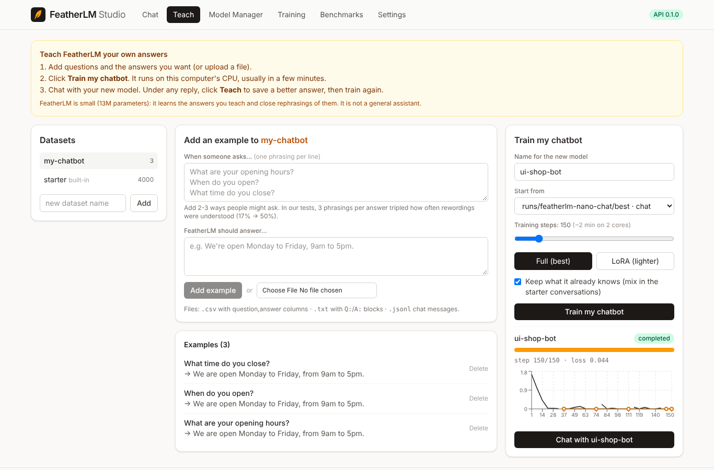
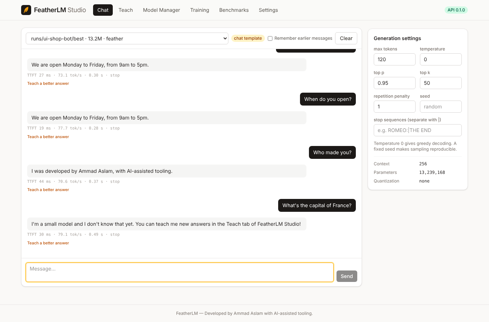

# FeatherLM as a chatbot you can teach

*Developed by Ammad Aslam with AI-assisted tooling.*

FeatherLM ships a small starter chatbot and lets anyone teach it new answers, from the web
app or the command line, on an ordinary CPU.

**Be clear about what this is.** FeatherLM Nano has 13 million parameters, about 10,000
times smaller than large assistants. It answers well on what it has been taught and on
close rephrasings of it. It does not know general facts, and when asked something outside
its training it is taught to say so instead of making something up.

## 1. Build the starter chatbot

```bash
./scripts/make_chatbot.sh
```

This runs three steps (skipping any that are already done):

| Step | Command | Time on 2 CPU cores |
|---|---|---|
| Pretrain the base model on Shakespeare | `python train.py --config configs/nano_cpu.yaml` | ~40 min |
| Write the starter conversations | `python -m featherlm.data.chat_starter --out data/chat/starter` | seconds |
| Fine-tune into a chatbot | `python finetune.py --config configs/chat_nano.yaml` | ~15 min |

The result is `runs/featherlm-nano-chat/best`. Studio's Chat tab picks it automatically.

The starter data (`featherlm/data/chat_starter.py`, MIT) covers greetings, what FeatherLM
is, who made it, benefits, hardware, installation, training, teaching, limitations,
memory, license, privacy, jokes, Shakespeare quotes from the public-domain corpus, and honest answers when it can't help: "I don't know
that yet" for other questions, and "I'm not reliable at maths yet" for arithmetic (a model
this small memorises sums instead of learning to add, and would otherwise give confident
wrong answers). Two phrasings per topic are held out of training to measure generalisation:

```bash
python -m featherlm.benchmarks.chat_eval --model runs/featherlm-nano-chat/best \
  --data data/chat/starter/eval_heldout.jsonl
```

Results are in [the results section](#results).

## 2. Teach it in FeatherLM Studio




Start the server (`python -m uvicorn api.main:app --port 8000`) and open http://127.0.0.1:8000.

1. **Teach tab**: pick or create a dataset (e.g. `my-chatbot`) and add examples:
   *When someone asks…* / *FeatherLM should answer…*. Or upload a file:
   * `.csv` with `question,answer` columns
   * `.txt` with blocks of `Q: …` and `A: …` separated by blank lines
   * `.jsonl` with `{"messages": [...]}`, `{"prompt", "completion"}` or `{"question", "answer"}` per line
2. Click **Train my chatbot**. Training runs in the background on the CPU with a live
   progress bar and loss chart. 200 steps take about 2-3 minutes on 2 cores.
3. Click **Chat with …** to talk to your new model.
4. In the Chat tab, click **Teach a better answer** under any reply to save a correction
   into your dataset, then train again.

Options:

| Option | Default | Meaning |
|---|---|---|
| Start from | the starter chatbot | the model your training builds on |
| Training steps | 200 | more steps fit your examples more tightly |
| Full / LoRA | Full | Full updates all weights (best quality); LoRA trains small adapters (lighter, also saves `lora_adapter.safetensors`) |
| Keep what it already knows | on | mixes starter conversations into training so the bot does not forget them |

How a run is built (`api/services/teach.py`): each taught example is repeated (4-60 times,
depending on how many you have) with light rewording of the question (case, punctuation,
"please", "FeatherLM,"), mixed with starter conversations, and the loss is computed only on
the assistant's answers. Validation uses your original examples.

Every teach endpoint is an admin endpoint: it needs `FEATHERLM_ADMIN_KEY`, or a direct
connection from the same computer when no key is set.

## 3. From the command line

```bash
# your examples
cat > data/chat/mine.jsonl <<'EOF'
{"question": "What are your opening hours?", "answer": "We are open Monday to Friday, 9am to 5pm."}
{"question": "Where is the shop?", "answer": "We are at 12 Main Street."}
EOF
```

Then write a config like `configs/chat_nano.yaml` with
`finetune.init_from: runs/featherlm-nano-chat/best`, `data.train_file: data/chat/mine.jsonl`
and run `python finetune.py --config <your config>`. The Studio flow above also mixes in
starter data and repeats your examples; the CLI uses exactly the file you give it.

Chat in the terminal:

```bash
python inference.py --model runs/featherlm-nano-chat/best --chat --temperature 0 --repetition-penalty 1
```



### Answering one question at a time

By default Studio and the terminal chat send only your latest message. FeatherLM's chat
data is mostly single questions, and in testing a few earlier turns were enough to make
it drift (for example, answering "Who made you?" with the end of a previous answer),
while the same questions asked on their own were answered correctly. Tick
**Remember earlier messages** in Studio (or pass `--history`) to send the conversation;
the server always trims history to fit the model's 256-token context.

Replies use temperature 0 (always the most likely answer) by default: with sampling, the
bot occasionally miscopied details such as the GitHub link.

## 4. API

```bash
curl http://127.0.0.1:8000/v1/chat/completions -H "Content-Type: application/json" \
  -d '{"model": "runs/featherlm-nano-chat/best", "temperature": 0,
       "messages": [{"role": "user", "content": "How do I install FeatherLM?"}]}'
```

| Endpoint | Purpose |
|---|---|
| `GET /teach/datasets` | list datasets (the built-in `starter` is read-only) |
| `POST /teach/datasets` | create `{"name"}` |
| `GET /teach/datasets/{name}/examples` | list examples, newest first |
| `POST /teach/datasets/{name}/examples` | add `{"question", "answer"}` or `{"messages"}` (creates the dataset if needed) |
| `DELETE /teach/datasets/{name}/examples/{id}` | remove one example |
| `POST /teach/datasets/{name}/upload` | add from a `.csv`, `.txt` or `.jsonl` file (max 5 MB) |
| `POST /teach/train` | `{"name", "dataset", "base_model"?, "steps", "mode", "include_starter"}` → background job; the new model is `runs/<name>/best` |
| `GET /teach/base-models` | models you can start from |

Progress of a training run: `GET /training/jobs/{id}` and `/training/jobs/{id}/metrics`.

## Results

Measured on the reference machine (2-vCPU Xeon, no GPU), greedy decoding.

**Starter chatbot** (`runs/featherlm-nano-chat/best`, 900 fine-tuning steps, ~20 min):
28 of 42 held-out questions answered correctly (67%). These
phrasings never appear in training. Per topic: benefits 0/2, bye 1/2, creator 0/2, gpu 1/2, greet 2/2, how_are_you 1/2, identity 0/2, install 2/2, joke 2/2, license 1/2, limits 2/2, math 4/4, memory 0/2, privacy 2/2, shakespeare 2/2, teach 2/2, thanks 1/2, train 2/2, unknown 2/2, what_is 1/2.
Asked in the exact phrasings it was trained on, it answers reliably; rewordings are its
weak spot, because its only pretraining was Shakespeare, so it matches on familiar words
more than on meaning.

**Teaching** (`scripts/eval_teaching.py`: a 6-question shop FAQ taught through the same code
path as the Teach tab, 200 full fine-tuning steps, starter conversations mixed in):

| Taught phrasings per answer | Training time | Taught questions | Unseen rephrasings | Starter held-out before → after |
|---|---|---|---|---|
| 1 | 3.4 min | 100% | 17% | 67% → 64% |
| 3 | 3.3 min | 100% | 50% | 67% → 62% |

So: what you teach, it reliably repeats; giving 2-3 phrasings per answer triples how often
new wordings are understood; and it keeps most of what it knew. Expect to add phrasings
for questions your users actually ask, which is how small intent-style chatbots are
normally built.

Raw results: `results/chat_eval.json`, `results/teach_eval.json`, `results/teach_eval_3phrasings.json`.

**Next improvements:** pretraining on a larger modern-English corpus (the biggest lever for
understanding rewordings), and longer multi-turn training conversations so remembering
history works as well as single questions.
